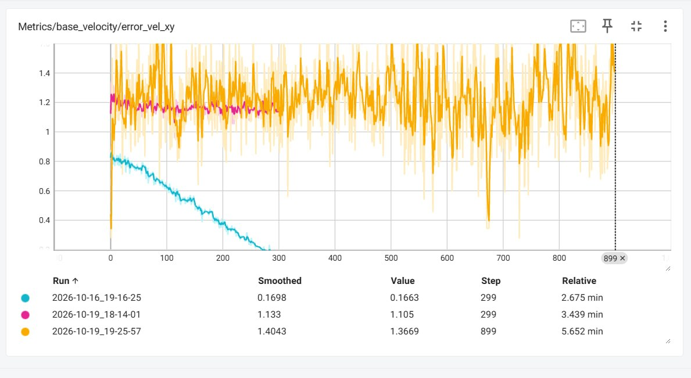
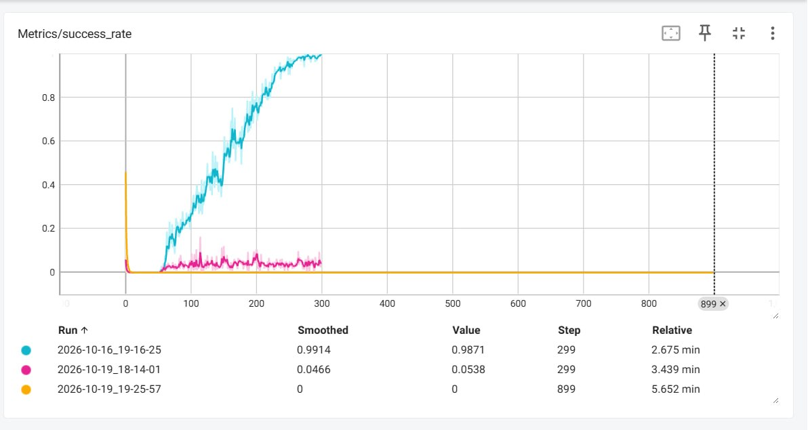
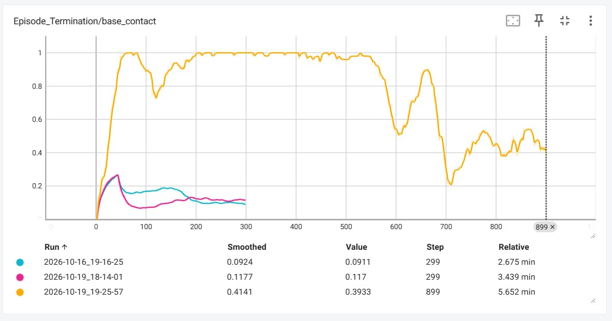

## 1. My prediction

Before training the modified policy, I expected that increasing the linear velocity range from -1 to +1 m/s to -2 to +2 m/s would make the task harder. The robot would have to learn to follow faster commands while still keeping its balance, so I expected the velocity error to increase, the success rate to decrease, and the base contact termination rate to increase.

I also expected that training the modified policy for three times more iterations would improve its performance. My reasoning was that the policy might need more time and experience to learn how to handle the wider range of commands.

## 2. What actually happened?

After training both modified policies, I compared their TensorBoard graphs with the original policy.

### Velocity-tracking error (`error_vel_xy`)

The original policy (blue) showed a decrease in velocity error and had the lowest error of all three runs. This means that it became better at following the commanded velocity during training.

The first modified policy (pink) remained almost stable, with little improvement. The longer training run (orange) fluctuated a lot instead of showing consistent progress.

This was different from what I expected from the longer run. I thought that more iterations would help the policy learn better, but its error did not show clear improvement.

### Success rate (`success_rate`)

The original policy reached a final success rate of 0.9871, or approximately 98.7%. The first modified policy reached 0.0538, or approximately 5.4%, while the longer training run ended at 0.

The difference is very large. The original policy learned to perform the task successfully, while both modified policies performed much worse. The longer run did not recover, even after training for three times as many iterations.

### Base contact termination (`Episode_Termination/base_contact`)

The original policy ended with a value of 0.0911. The first modified policy reached 0.117, and the longer training run reached 0.3933.

The base contact value increased after widening the command range and became much higher in the longer run. This suggests that the modified policies had more difficulty maintaining stable movement and were more likely to terminate because of unwanted base contact.

Overall, the three metrics show that the original policy performed much better than both modified policies.

## 3. Did more training iterations fix the problem?

No. Training the wider-range policy for approximately three times as many iterations did not fix the problem.

I initially thought that the modified policy might simply need more training to learn the wider range of commands. However, the longer run had a success rate of zero, a much higher base contact value, and a velocity error that fluctuated considerably.

This suggests that the problem was not just that the policy needed more iterations. The wider command range may have made the task significantly harder to learn, and increasing the training duration alone was not enough to solve it.

However, I cannot say exactly what caused the failure from these graphs alone. It could be related to the difficulty of tracking higher velocities, the reward function, or instability during training. More experiments would be needed to determine the exact cause.

